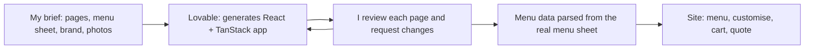

# The Lemon Bowl: website redesign

> A customer website for my catering business in Delhi NCR, built with Lovable from my brief: browse the menu, customise dishes, build a cart and request a catering quote.

**Status:** Redesign built, not yet live on the business domain · **Live demo:** _coming soon at ytodi96.github.io/lemonbowl-website_

## The problem

The Lemon Bowl sells platters, catering and festive gifting, mostly through WhatsApp. The current site (on Shopify) works as a shop, but it doesn't help a customer plan an event: they can't see how a dish scales from 10 to 80 guests, change ingredients, or ask for a catering quote without a long back-and-forth with the sales rep.

## What it does

- **Menu with filters:** course tabs, cuisine chips and dietary filters across the full catalogue.
- **Dish pages with customisation:** photo gallery, portion size, ingredient removals, serving format surcharges and allergy notes, all priced live.
- **Cart:** per-line customisation tags, order notes and a running total.
- **Catering:** a build-your-own flow and a quote request form.
- **Occasions and gifting:** festive menus, subscriptions and corporate gifting pages.


<!-- TODO: add a homepage screenshot or a 15-second GIF of menu -> dish -> cart. -->

## How it works



- **Stack:** React 19, TanStack Start/Router (file-based routes), Tailwind CSS 4, shadcn/ui.
- `source/src/routes/`: one file per page.
- `source/src/lib/menu.ts`: the product catalogue. `customize.ts`: portion, removal and serving-format pricing. `cart.tsx`: cart state.
- `source/src/styles.css`: design tokens (gold `#E3B23C`, cream `#FAF6ED`, charcoal `#2B2620`; Playfair Display and Work Sans; 150–250ms motion).
- `static-site/`: a static HTML snapshot of every page with its photos, used for the live demo. The cart, filters and forms are not active in the snapshot.

## What I asked for

A site where customers can browse the menu, customise dishes, build a cart and request a catering quote, without needing a WhatsApp conversation to get started.

## What I changed

- **Rebuilt the menu from our real menu sheet**, so every dish, course and price matches what we actually sell.
- **Added dietary filters**, so guests can narrow the menu by diet in one tap.
- **Added serving-format pricing**, so the price updates when a customer changes how a dish is served.

## Design decisions

The key choices are logged in [docs/decisions.md](docs/decisions.md).

## Run it yourself

```bash
git clone https://github.com/ytodi96/lemonbowl-website.git && cd lemonbowl-website/source
npm install
npm run dev
```

Note: most photos are stored in Lovable's asset service (`*.asset.json` pointers), so they only load on Lovable hosting.

## What I'd do next

1. Connect the catering quote form to the [Sales Copilot](https://github.com/ytodi96/lemonbowl-sales-copilot), so a quote request arrives as a drafted menu and price for the rep to approve.
2. Add online payments, so a customer can confirm and pay for an order on the site.

## Data & privacy

The menu and prices are already public. Phone numbers on the site are placeholders (`+91 99999 99999`), and the reviews page credits customers by occasion and area only, never by name. The repo contains no customer data, orders or API keys, and every push runs the [leak guard](docs/leak-guard.md).
